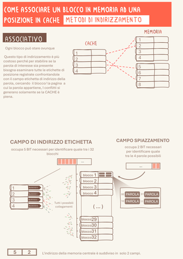
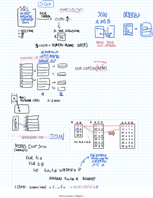
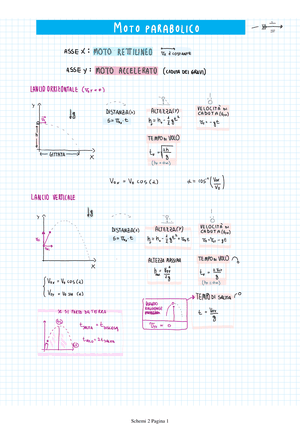
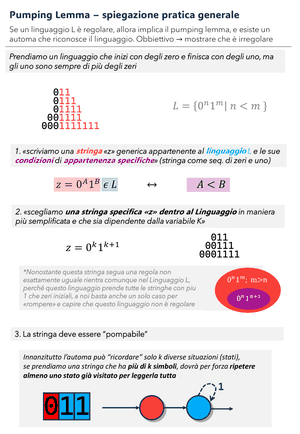

# Vocabolario di stile per generare schemi di studio (tirocinio UniVR)

Dai miei schemi di studio ho estratto un vocabolario di regole: lo dai a GPT o Claude in chat con la pagina del prof, e il modello fa lo schema nel mio stile; gli strumenti misurano quanto ci somiglia.

**Il mio stile** (le mie pagine, da cui nascono le regole): 
    
[tutte le pagine →](i_miei_schemi/)

**Cosa ho imparato dagli esperimenti** (cosa ha funzionato, cosa no): [documenti_tirocinio/cosa_abbiamo_imparato/](documenti_tirocinio/cosa_abbiamo_imparato/)

**Usalo in 3 passi**
1. Apri la **Demo** in Colab qui sotto (serve un account Google, niente chiavi): *Runtime > Esegui tutto*, alla fine scarichi `per_GPT.zip`.
2. In una chat con GPT o Claude allega dallo zip `PACCHETTO_MODELLO.md`, `FRASI_PER_IL_MODELLO.md` e `numeri.json`, più la pagina del prof; poi incolla il testo di `PROMPT_PER_GPT.txt`.
3. Se lo schema esce male scrivi «non hai rispettato la regola X, correggi solo questo», poi «quale regola non era chiara?». Esempio di com'è venuto a me: [esempi_confronti/](esempi_confronti/).

| Prova in 1 clic, niente chiavi | |
|---|---|
|  | **Demo**: misura i numeri, controlla una pagina OK/FUORI, ti dà `per_GPT.zip` da allegare in chat |
|  | **Collega**: carichi i tuoi schemi e le pagine del prof, ti dice da quale pagina viene ogni appunto |

<table><tr>
<td width="50%"> <b>Collega schema e pagina del prof</b>: stesso numero e colore = stesso pezzo (clic = video)</td>
<td width="50%"> <b>Numeri e controllo OK/FUORI</b>: la pagina generata dentro o fuori dai miei numeri (clic = video)</td>
</tr></table>

| Cartella | Cosa ci trovi |
|---|---|
| [`i_miei_schemi/`](i_miei_schemi/) | le mie pagine di studio, di materie diverse: la fonte dello stile |
| [`vocabolario/`](vocabolario/) | le regole; in `pronto_per_il_modello/` tutto in un file da dare al modello |
| [`trascrivi_lezioni/`](trascrivi_lezioni/) | il testo di una lezione, con chi parla (Whisper su GPU Colab) |
| [`collega_schema_a_pagina_prof/`](collega_schema_a_pagina_prof/) | da quale pagina del prof nasce ogni appunto: il notebook Collega e gli script dal PC |
| [`strumenti/`](strumenti/) | il notebook Demo · 1 misura stile dai numeri · 2 grafiche per spiegare le regole |
| [`esempi_confronti/`](esempi_confronti/) | il mio schema, l'AI senza regole e con le mie regole |
| [`documenti_tirocinio/`](documenti_tirocinio/) | cosa ho imparato dagli esperimenti, spiegazioni lunghe, 8 video tutorial, i miei appunti di Architettura, le grafiche di questa pagina |

Parti dal [video 0: il repo in 2 minuti](documenti_tirocinio/video/0_il_repo_in_2_minuti.mp4). Ogni file, uno per uno: [mappa_file.svg](documenti_tirocinio/immagini_readme/mappa_file.svg). Versione vecchia: tab *Commits* → *Browse files* → *Code* → *Download ZIP*.
