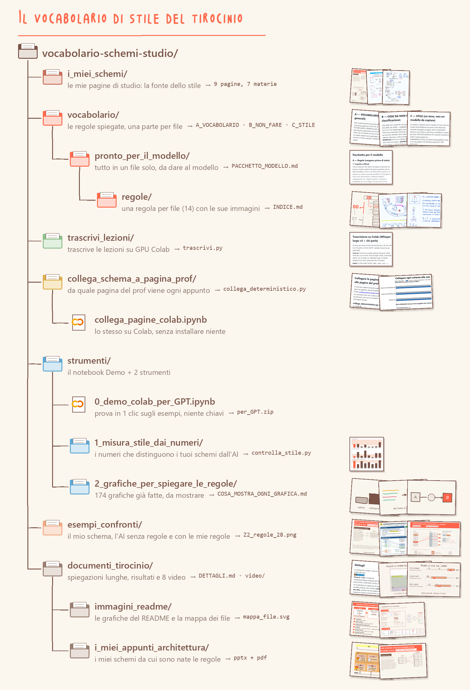

# Documenti del tirocinio

Cosa ho imparato dagli esperimenti, spiegazioni lunghe, video tutorial, i miei appunti di Architettura e le grafiche del README. Ti serve quando vuoi capire come è stato fatto il lavoro, non per usarlo.

| Cosa | Cosa c'è dentro |
|---|---|
| [cosa_abbiamo_imparato/](cosa_abbiamo_imparato/) | **il riassunto:** gli esperimenti messi per esito (ha funzionato, non ha funzionato, rifatto più volte, fatto male), una riga ciascuno |
| [DETTAGLI.md](DETTAGLI.md) | come si usa il vocabolario, come si estraggono regole nuove, risultati |
| [video/](video/) | 8 video tutorial (da 20 secondi a 2 minuti), elencati sotto; in `video/gif/` le GIF dei video 3 e 4 che si muovono in cima al README |
| [i_miei_appunti_architettura/](i_miei_appunti_architettura/) | i miei schemi di Architettura degli elaboratori, fatti a mano in PowerPoint: da qui sono partite le regole |
| [immagini_readme/](immagini_readme/) | le grafiche qui sotto e [mappa_file.svg](immagini_readme/mappa_file.svg) (ogni file del repo, cos'è e quando ti serve) |

## Video tutorial

| # | Video | Cosa mostra |
|---|---|---|
| 0 | [**Il repo in 2 minuti**](video/0_il_repo_in_2_minuti.mp4) | **parti da qui:** giro vero del repo, cosa rappresenta ogni cartella e file |
| 1 | [Panoramica del repo](video/1_panoramica_repo.mp4) | cosa c'è in ogni cartella e da dove partire |
| 2 | [Demo Colab → per_GPT.zip](video/2_demo_colab_per_GPT.mp4) | un clic: numeri, controllo OK/FUORI, zip da dare al modello |
| 3 | [Collega schema e pagina del prof](video/3_collega_schema_pagina_prof.mp4) | stesso numero e colore = stesso pezzo; con testo 15/15 |
| 4 | [Numeri e controllo OK/FUORI](video/4_numeri_OK_FUORI.mp4) | i 4 numeri che cambiano il modello e `controlla_stile.py` |
| 5 | [Chat Claude gratuita](video/5_chat_claude_gratuita.mp4) | 3 file + 1 riga, poi «correggi»: 2 difetti sistemati |
| 6 | [Usare il codice](video/6_usare_il_codice.mp4) | i 3 comandi lanciati davvero, con il loro output: misura, controlla OK/FUORI, collega |
| 7 | [In chat, passo per passo](video/7_in_chat_passo_passo.mp4) | quali file allegare e cosa scrivere: prompt, «correggi», «quale regola non era chiara?» |

I video sono stati registrati prima dei rinomini: mostrano i nomi vecchi delle cartelle (`grafiche_regole`, `esempi_schemi_e_pagine_generate`, `completo`, `docs`, `img`).

## i_miei_appunti_architettura/

- `Architettura_schemi_esercizi_7pagine.pdf`: schemi degli esercizi (cache, banchi di memoria, microistruzioni), 7 pagine. Lo stesso PDF è in `strumenti/1_misura_stile_dai_numeri/esempi_numeri/suoi/`.
- `Architettura_schemi_esercizi_modificabile.pptx`: lo stesso, in PowerPoint modificabile (10 slide, 2 nascoste).
- `Architettura_schemi_a_icone_20pagine.pdf`: l'altra versione, con tante icone, 20 pagine.

Solo i miei schemi: le pagine del docente (materiale del corso) qui non ci sono.

## Le grafiche del repo

