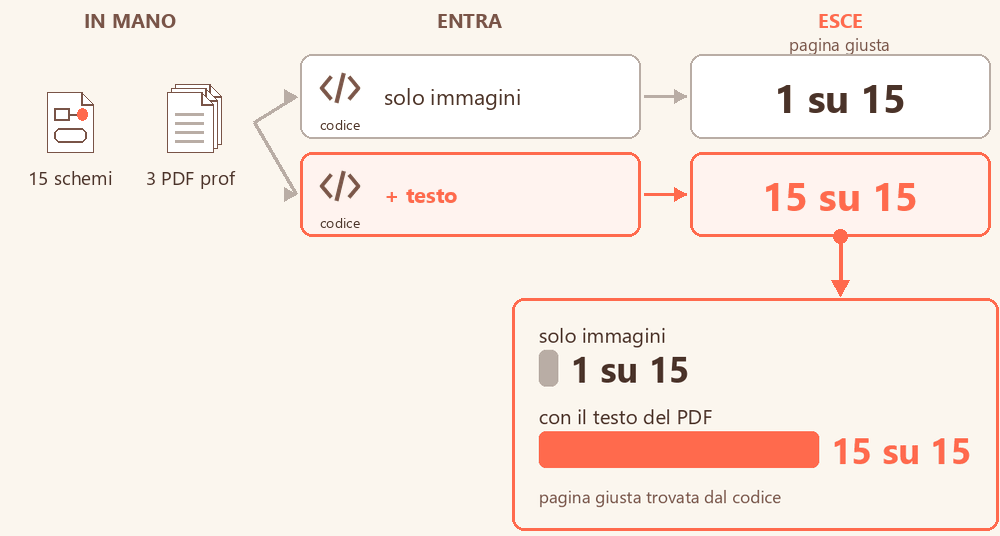
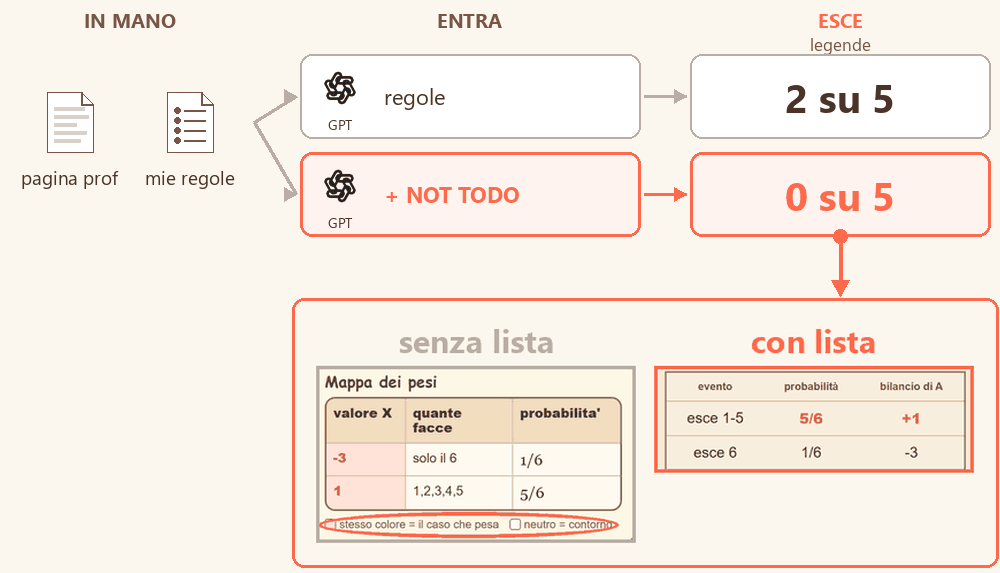
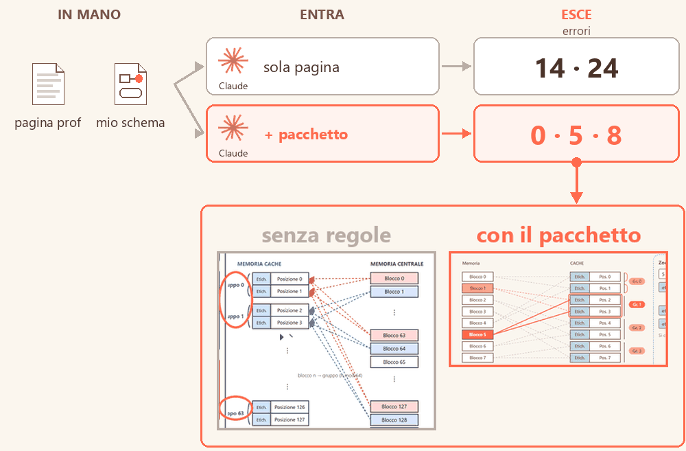
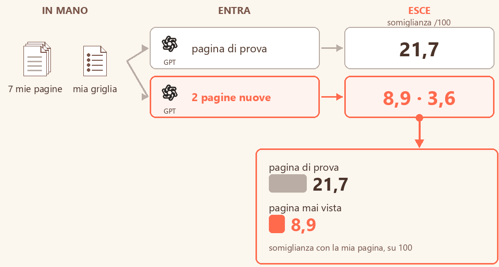
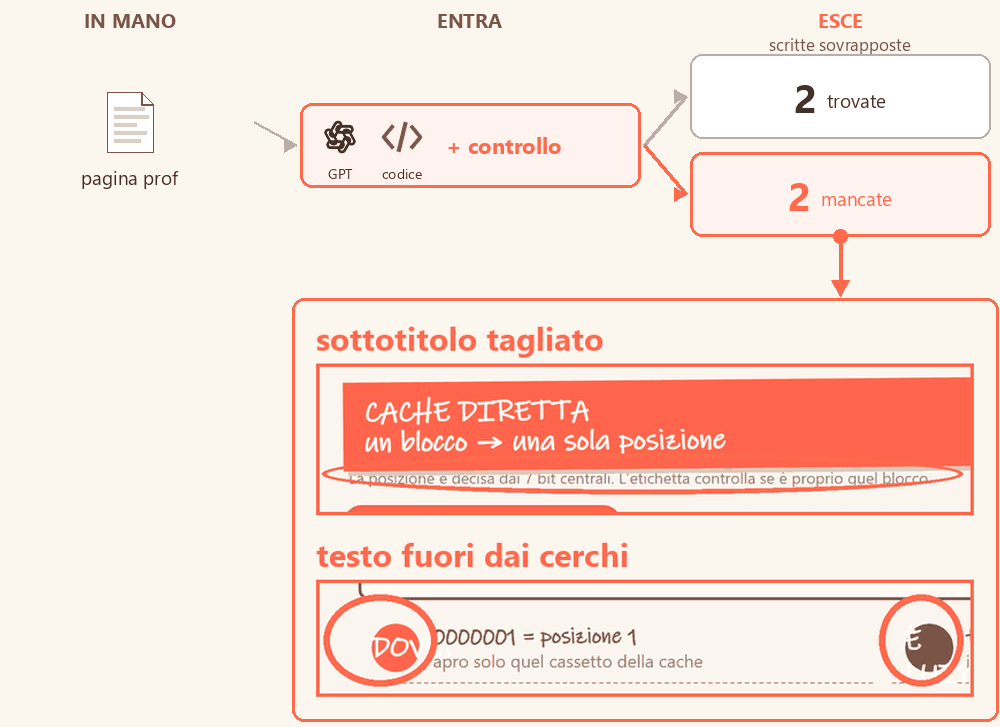

# Cosa abbiamo imparato

Gli esperimenti con agenti AI per far fare schemi di studio nel mio stile, quelli che servono a chi usa il vocabolario, messi in ordine per **esito**. 
Ogni voce è un caso chiuso: il **titolo** è la conclusione, sotto una frase con cosa ho provato, poi il disegno (cosa entra, cosa esce, attaccata al numero la prova; in corallo il punto da guardare) e cosa ne ho fatto. Il testo completo si apre con «dettagli».

|  |  |
|---|---|
| da tenere | da evitare |

Accanto a ogni titolo, quanto posso dirlo:  più pagine o più giri, differenza netta, conteggio verificato ·  un esperimento solo ma ripetuto, o differenza netta su pochi casi. Quello che ho visto una volta sola resta fuori finché non lo rifaccio.

Parole che uso: **le mie regole** = il mio vocabolario scritto (14 regole in 5 gruppi: cognitive offload, transcodifica, percorso dall'inizio alla fine, disegno, attenzione) · **pacchetto** = le 14 regole + la lista delle cose da non fare + il tono, in un file solo · **errori di impaginazione** = scritte sovrapposte, tagliate o fuori dal foglio, contate dal codice nel browser.

##  Ha funzionato

### Col testo il codice trova la pagina 

Ho fatto cercare al codice da quale pagina dei PDF del prof viene ogni mio schema: prima confrontando solo le immagini, poi anche il testo.

**Quindi:** ne è uscito lo strumento [collega](../../collega_schema_a_pagina_prof/): codice col testo, Gemini solo se il PDF non ha testo. (Quanto è sicuro: 15 schemi su 314 pagine, contati dal codice.)

dettagli

<b>In mano:</b> 15 miei schemi di Architettura di cui so la pagina d'origine e 3 PDF del prof (314 pagine). 
<b>Entrato:</b> nessun modello: il codice cerca le parole rare in comune; se il PDF non ha testo, confronta le immagini. Per confronto, Gemini su tutte le pagine. 
<b>Uscito:</b> pagina giusta (±1) <b>15 su 15</b> con il testo, <b>1 su 15</b> con le sole immagini; Gemini sulle immagini 13 su 15. 
<b>Quindi:</b> ne è uscito lo strumento <a href="../../collega_schema_a_pagina_prof/">collega</a>: codice col testo, Gemini solo senza testo. 
<b>Quanto è sicuro:</b> 15 schemi su 3 PDF (314 pagine), conteggio fatto dal codice: 15 su 15 contro 1 su 15. (F0-09)

### La lista NOT TODO toglie le legende 

Ho chiesto a GPT di rifare una pagina con le mie regole, 5 volte così e 5 volte aggiungendo la lista delle cose da non fare.

**Quindi:** la lista NOT TODO resta nel pacchetto. (Quanto è sicuro: rifatta su 2 pagine, 4 su 10 → 0 su 10; un modello solo.)

dettagli

<b>In mano:</b> una pagina del prof di Statistica sul valore medio e le mie regole. 
<b>Entrato:</b> a GPT, 5 volte la pagina + le mie regole, e altre 5 volte le stesse con in fondo la lista delle cose da non fare (es. «niente legende: se serve la legenda, va cambiato il disegno»). 
<b>Uscito:</b> pagine con un riquadro-legenda dei colori («corallo = caso seguito») <b>2 su 5 → 0 su 5</b>. 
<b>Quindi:</b> la lista NOT TODO resta nel pacchetto. 
<b>Quanto è sicuro:</b> rifatta su 2 pagine (questa e una di Architettura sulla cache), 5 prove per lato su ognuna: legende 4 su 10 → 0 su 10; un solo modello, un giro. (E-39)

### Il pacchetto toglie quasi tutti i difetti 

Ho chiesto a Claude di trasformare la stessa pagina, prima da sola e poi con il pacchetto delle mie regole.

**Quindi:** il pacchetto è la base di ogni prova; per le forme a mano non basta. (Quanto è sicuro: una pagina, ma il peggiore con il pacchetto resta sotto il migliore senza.)

dettagli

<b>In mano:</b> una pagina del prof di Architettura sulla cache associativa a gruppi e il mio schema della stessa pagina. 
<b>Entrato:</b> a Claude, 2 volte la sola pagina del prof, 3 volte la pagina + il pacchetto (es. «4.3 Effetto martellante: ripropongo la stessa forma», «il corallo sta sotto il 10% dell'area»). 
<b>Uscito:</b> errori di impaginazione <b>14 e 24 → 0, 5 e 8</b>: senza regole quasi tutte scritte coperte da altri elementi. 
<b>Quindi:</b> il pacchetto è la base di ogni prova; non basta per le forme a mano, che Claude ignora 3 volte su 3. 
<b>Quanto è sicuro:</b> una sola pagina, 2 prove senza e 3 con; la peggiore con il pacchetto (8) resta sotto la migliore senza (14). (E-40)

[↑ torna all'indice](#indice)

##  Non ha funzionato

### La logica da sola crolla su pagine nuove 

Ho fatto scrivere a GPT la logica dei miei appunti da 4 pagine, poi gli ho fatto rifare con quella sola logica pagine che non aveva mai visto.

**Quindi:** scartata come strada unica. (Quanto è sicuro: un giro solo, ma il calo è netto su tutte e due le pagine nuove.)

dettagli

<b>In mano:</b> le mie 7 pagine di esercizi di Architettura: 4 per imparare, 1 di prova, 2 tenute nascoste. 
<b>Entrato:</b> a GPT, le 4 pagine + la mia griglia («PASSO 1 separa TESTO da IMMAGINE…») per scrivere la logica dei miei appunti; poi solo la logica + il testo di una pagina, da rifare come l'avrei fatta io. 
<b>Uscito:</b> somiglianza con la mia pagina <b>21,7</b> sulla pagina di prova (e scende dopo 2 correzioni), <b>8,9 e 3,6</b> sulle due nascoste. 
<b>Quindi:</b> scartata come strada unica. 
<b>Quanto è sicuro:</b> un giro solo, ma il calo è netto su tutte e due le pagine nascoste (8,9 e 3,6 contro 17-22 sulla pagina di prova). 
<b>Come funziona:</b> il codice sfoca le due pagine e confronta solo dove c'è inchiostro: 100 = uguali. (F0-03)

### Il controllo automatico non vede tutto 

Ho fatto cercare nel browser le scritte sovrapposte nella pagina fatta da GPT, rimandandogli gli errori da correggere.

**Quindi:** il controllo non sostituisce lo sguardo. (Quanto è sicuro: per dire «non vede tutto» basta un caso, visto a occhio.)

dettagli

<b>In mano:</b> una pagina del prof di Architettura sulla cache a indirizzamento diretto. 
<b>Entrato:</b> a GPT, la pagina + le mie regole in principi; il controllo nel browser cerca le scritte sovrapposte e rimanda gli errori a GPT per correggere. 
<b>Uscito:</b> trova <b>2</b> sovrapposizioni («DOVE?» sopra «0000001 = posizione 1»), che restano 2 dopo la correzione; non vede il sottotitolo tagliato né il testo fuori dai cerchi. 
<b>Quindi:</b> il controllo non sostituisce lo sguardo. 
<b>Quanto è sicuro:</b> per dire «non vede tutto» basta un caso: una pagina, 2 giri, i 2 difetti mancati visti a occhio. (E-18)

[↑ torna all'indice](#indice)

---

Qui ci sono solo i risultati solidi e utili a chi usa il vocabolario (5 su 18 esperimenti riassunti): gli altri sono indizi da rifare o note su come ho lavorato, e restano nel mio catalogo. 
Il catalogo completo (184 voci, prompt e log) resta privato.
