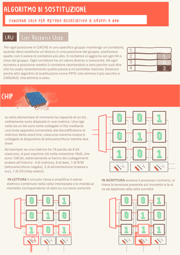
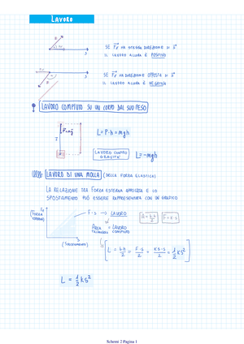
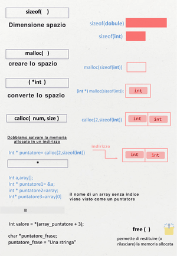
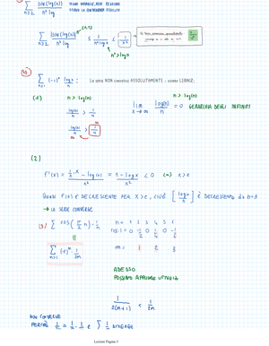
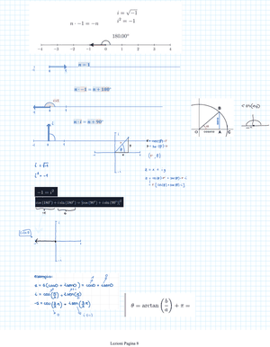

# I miei schemi

Da qui nasce tutto il resto: queste sono pagine dei miei quaderni, di materie diverse. Le regole del [vocabolario](../vocabolario/) le ho ricavate guardando pagine come queste. 
Clic su una miniatura per la pagina grande.

<table>
<tr>
<td width="20%" valign="top"> <b>Architettura</b> · blocco di memoria e posizione in cache, con il caso disegnato</td>
<td width="20%" valign="top"> <b>Architettura</b> · sostituzione LRU con i contatori, e il chip di memoria</td>
<td width="20%" valign="top"> <b>Basi di Dati</b> · costo di scan, join e order by, a mano</td>
<td width="20%" valign="top"> <b>Fisica</b> · moto parabolico diviso nei due assi</td>
<td width="20%" valign="top"> <b>Fisica</b> · lavoro, forza peso e molla</td>
</tr>
<tr>
<td width="20%" valign="top"> <b>Linguaggi formali</b> · pumping lemma seguito su un linguaggio</td>
<td width="20%" valign="top"> <b>Programmazione</b> · sizeof, malloc e calloc come spazio disegnato</td>
<td width="20%" valign="top"> <b>Analisi</b> · convergenza di una serie, passo per passo</td>
<td width="20%" valign="top"> <b>Algebra</b> · numeri complessi sul piano</td>
</tr>
</table>
